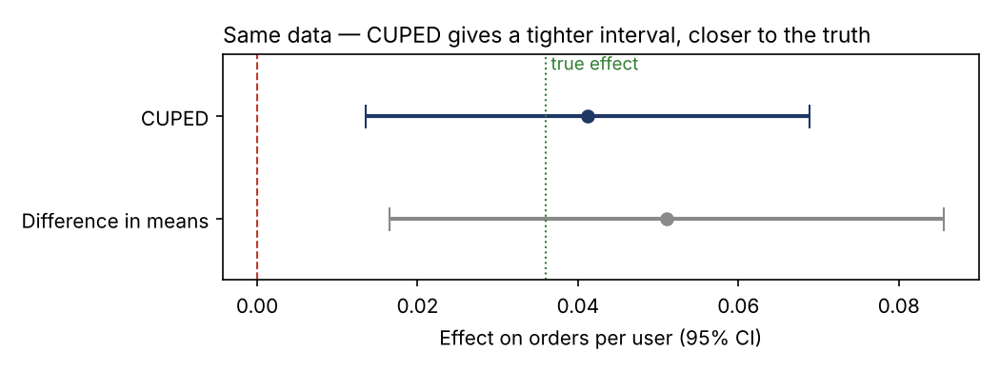
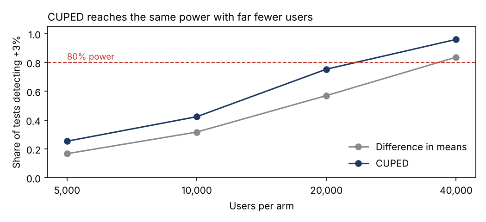

# Variance reduction in A/B tests with CUPED

A worked example on synthetic data: how much does CUPED tighten an experiment's estimate, and does it stay honest?

CUPED adjusts the test metric using each user's behaviour from **before** the experiment. Users who ordered a lot before tend to order a lot during the test too. Removing that predictable part leaves less noise around the treatment effect.

```
Y_cuped = Y − θ · (X − mean(X)),   θ = cov(X, Y) / var(X)
```

## Results

Simulation: 20,000 users per arm, outcome = orders per user over 4 weeks, true effect +3%, pre-period = the same metric over the 4 weeks before the test (correlation 0.60).

| | Difference in means | CUPED |
|---|---|---|
| Estimated lift (true: +3.0%) | +4.3% | +3.4% |
| 95% CI width (orders per user) | 0.069 | 0.055 |
| Variance of the metric | baseline | −36% |
| False positive rate in 1,000 A/A tests | 5.0% | 4.9% |
| Users per arm for 80% power (approx.) | ~36,000 | ~23,000 |





**What the numbers show**
- Variance falls by about `corr²` (36%), so the same precision needs roughly two thirds of the sample.
- In this run the treatment group happened to order 1.4% more before the test. The plain estimate counts that gap as effect; CUPED removes it and lands closer to the true lift.
- The A/A check keeps the false positive rate at the nominal 5%, so the gain doesn't come from extra false alarms.

## Practical notes

- Estimate θ on **both groups pooled**, not per group.
- The covariate must be measured before assignment, so the treatment can't affect it.
- New users have no history: set `X = 0` and add a new-user indicator, or analyse them as a separate stratum.
- For heavy-tailed metrics such as revenue, cap outliers before computing θ.

## Run it

```
pip install -r requirements.txt
jupyter notebook cuped_ab_test.ipynb
```

All data is simulated, with a fixed random seed. The notebook mirrors an approach I used on product experiments; the production code and data belong to my former employer.
